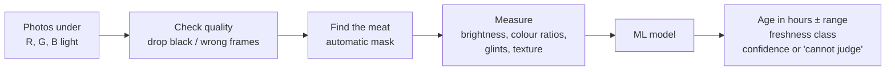

# FoodLens: chicken freshness from R/G/B-LED smartphone photos

FoodLens estimates **how long raw chicken has been at room temperature** (hours) and gives a **freshness class** (fresh / use-soon / spoiled-risk). The input is photos taken in a dark box under red, green and blue LED light with fixed phone-camera settings. It builds on the smartphone light-scatter biosensor of **Liang, Park & Yoon (2014, Sci. Rep. 4:5953)** and the multi-angle scatter classification of **Sweeney & Yoon (2017, IEEE Sens. J.)**.

> Status: **P0 foundation done (S02, 2026-11-18): package skeleton, config, CLI stubs, check gate. Next: P1 ingest & QC.** See `plan/PROGRESS.md`.

## 1. How it works (simple version)

- **Why three colours?** Fresh and ageing meat absorb and scatter red, green and blue light differently (myoglobin oxidation, drying, slime). Comparing the three is like Paper 24 comparing several angles.
- **Why not count bacteria directly?** One bacterium is ~1 µm; one pixel covers ~40 µm of meat. Bacteria are invisible in the photo. Their **effects** (surface moisture, colour, texture) are visible. Bright spots are mostly reflections from moisture ("glints"), and we use them as moisture features.
- **Why is the evaluation strict?** Photos one minute apart are almost identical. Testing on the same chicken piece you trained on gives fake high scores. We always test on **pieces the model never saw**.

Details: [`docs/01_RESEARCH_AND_RATIONALE.md`](docs/01_RESEARCH_AND_RATIONALE.md) · first data check: [`docs/02_EDA_FINDINGS_INITIAL.md`](docs/02_EDA_FINDINGS_INITIAL.md) · architecture and diagrams: [`docs/03_ARCHITECTURE.md`](docs/03_ARCHITECTURE.md).

## 2. Theory in brief
| Concept | Value / meaning |
|---|---|
| Single bacterium (E. coli, Pseudomonas) | ~0.5–1 µm × 1–3 µm; refractive index ≈ 1.388 |
| Colony visible on agar | 1–3 mm, ~10⁷–10⁹ cells |
| Pixel footprint in our setup | ~40 µm, so single cells and micro-colonies are sub-pixel |
| Mie scattering | particles about the size of the wavelength (0.4–1 µm light vs 1–5 µm clusters) scatter strongly and angle-dependently (Paper 24) |
| Spoilage threshold (literature) | ~7 log CFU/g total viable count |
| Temperature effect | Ratkowsky model: growth rate ∝ (T − T_min)², so 1 h at 33 °C ≈ 1.5 h at 25 °C |
| What the camera sees change | moisture film → droplets → drying (glints); colour (myoglobin → metmyoglobin); texture |

## 3. Setup
```bash
brew install uv            # only if uv is missing (uv >= 0.11)
uv sync                    # creates .venv (Python 3.12) with the exact versions in uv.lock
bash scripts/check.sh      # ruff + pytest + size limits (+ notebooks); must end with CHECK RESULT: PASS
uv run foodlens --help     # lists the pipeline stages
```
- Always run Python through `uv run` (never a global `python3`/`pip`).
- Settings live in `configs/default.yaml` (validated by `foodlens.config`). Put raw sessions under `experiment/` (gitignored, never modified) and describe each one in `configs/samples.yaml`.
- Logging level: `FOODLENS_LOG=DEBUG uv run foodlens ...`. Notebook timeout: `FOODLENS_NB_TIMEOUT` (s, default 900).

## 4. Usage (after Phase P8)
```bash
uv run foodlens ingest && uv run foodlens qc && uv run foodlens roi
uv run foodlens features && uv run foodlens labels
uv run foodlens train --experiment final && uv run foodlens evaluate
uv run foodlens predict red.jpg green.jpg blue.jpg --temp 30
bash scripts/build_notebooks.sh   # generates and executes notebooks/*.ipynb
```

## 5. Project layout
See `docs/03_ARCHITECTURE.md` §6. Key folders: `src/foodlens` (code), `notebooks/src` (notebook sources), `configs/`, `plan/` (phase plans and progress), `docs/`, `reports/`.

## 6. Tech stack
Python 3.12 · uv · NumPy/pandas/pyarrow · Pillow/OpenCV/scikit-image · scikit-learn/statsmodels · PyTorch(MPS)+timm (embeddings) · jupytext/nbclient · pydantic · typer · ruff/pytest. Optional: FastAPI, Next.js + shadcn/ui + assistant-ui, Kotlin/Compose + CameraX, local LLMs via Ollama/MLX (see `docs/06_APP_DESIGN_OPTIONAL.md`).

## 7. Working with AI coding agents
All agents follow [`AGENTS.md`](AGENTS.md) (Claude reads `CLAUDE.md`, Gemini reads `GEMINI.md`; both point to it). Every session: read `plan/PROGRESS.md` → do one phase file → run `scripts/check.sh` → update progress → commit → print the next-session prompt (`plan/HANDOFF.md`).

## 8. Cleanup
- Project Python environment: `rm -rf .venv` (re-create with `uv sync`).
- Derived data: `rm -rf data/ reports/figures/` (re-create with the pipeline).
- Global tools and model caches: `bash scripts/uninstall_global_tools.sh` (prints the commands; add `--yes` to run them).

## 9. References
15. Adams JA, McCarty D, Crousore K (2006) Real-time on-line monitoring of process water for low concentrations of bacteria. Proc SPIE 6152, 61523M.
16. Hayden RT et al. (2016) Rapid antimicrobial susceptibility testing using forward laser light scatter technology. J Clin Microbiol 54:2701.
17. You DJ, Geshell KJ, Yoon J-Y (2011) Direct and sensitive detection of foodborne pathogens within fresh produce samples using a field-deployable handheld device. Biosens Bioelectron 28:399.
18. Alsulami TS et al. (2018) Rapid detection and differentiation of Staphylococcus colonies using an optical scattering technology. Anal Bioanal Chem 410:5445.
19. Nicolini AM, Fronczek CF, Yoon J-Y (2015) Droplet-based immunoassay on a 'sticky' nanofibrous surface for multiplexed and dual detection of bacteria using smartphones. Biosens Bioelectron 67:560.
20. Min HJ, Mina HA, Deering AJ, Bae E (2021) Development of a smartphone-based lateral-flow imaging system using machine-learning classifiers for detection of Salmonella spp. J Microbiol Methods 188:106288.
21. Zhu H, Sikora U, Ozcan A (2012) Quantum dot enabled detection of Escherichia coli using a cell-phone. Analyst 137:2541.
22. Dönmez Sİ, Needs SH, Osborn HMI, Edwards AD (2020) Label-free smartphone quantitation of bacteria by darkfield imaging of light scattering in fluoropolymer micro capillary film allows portable detection of bacteriophage lysis. Sens Actuators B 323:128645.
23. Sweeney RE, Yoon J-Y (2017) Angular photodiode array-based device to detect bacterial pathogens in a wound model. IEEE Sens J 17:6911.
24. Liang PS, Park TS, Yoon JY (2014) Rapid and reagentless detection of microbial contamination within meat utilizing a smartphone-based biosensor. Sci Rep 4:5953.

Further sources: see `docs/01_RESEARCH_AND_RATIONALE.md` §9.
