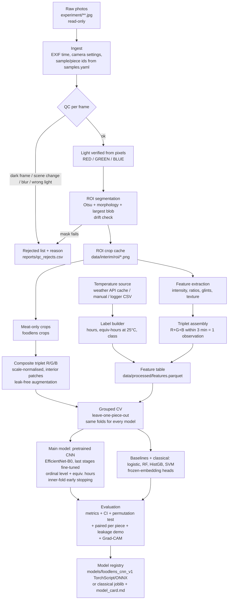
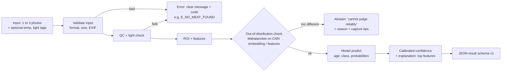
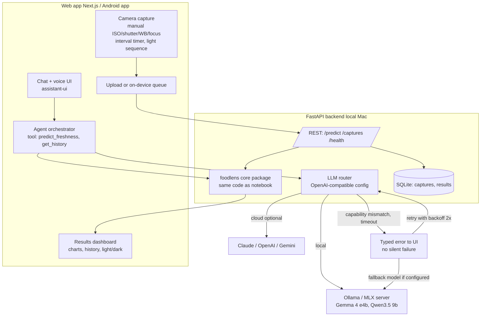

# FoodLens: Architecture, Pipeline and Project Structure

## 1. The ML pipeline in simple words
1. **Collect** photos: dark box, R/G/B LED each minute, fixed camera settings. *(data team)*
2. **Ingest**: read every photo once and record its time, camera settings, sample, piece and temperature in one table, the **manifest**. Original photos are never edited.
3. **Quality check (QC)**: drop black frames (LED off), wrong-scene frames and blurred frames. Confirm the light colour from the pixels.
4. **Find the meat (ROI)**: build an automatic mask of the chicken in each photo and save small cropped copies to a cache.
5. **Measure features / build CNN inputs**: (a) for the classical baselines, per light the median brightness, colour ratios between lights, glint (bright spot) count/area/size, and texture; (b) for the **main CNN model** (S10), the three meat-only crops of a triplet stacked into one colour image (R from the red photo, G from the green, B from the blue), resized to a common meat size and cut into patches inside the meat.
6. **Build labels**: hours since start, temperature-adjusted hours, freshness class.
7. **Train and evaluate fairly**: whole pieces are kept out for testing (grouped CV). The CNN (a pretrained network, top layers fine-tuned) and the classical models are scored on the **same** folds; compare with baselines, report confidence intervals. Grad-CAM maps show what the CNN looks at.
8. **Predict**: a new R/G/B photo triplet goes through steps 3–5 and the saved model (normally the CNN), which returns *age ± uncertainty, class, confidence*, or *"cannot judge"* if the input looks unlike the training data.

## 2. ML pipeline diagram


## 3. Inference flow (shared by notebook, CLI, API and app)


## 4. Optional app architecture (Phases 9–11)


## 5. Failure handling rules (apply everywhere)
| Failure | Detection | Behaviour |
|---|---|---|
| Unreadable/corrupt image | PIL error | Skip, log to rejects with reason `E_DECODE` |
| No timestamp | EXIF and filename both missing | Reject `E_NO_TIME` (never guess) |
| LED off / black frame | ROI p95 < threshold | Reject `E_DARK_FRAME` |
| Scene change | ROI area or position jumps > threshold vs session median | Reject `E_SCENE_CHANGE` |
| Light mismatch | pixel dominant ≠ schedule | Use pixel light, log `W_LIGHT_MISMATCH` |
| Incomplete triplet | missing colour within window | Model variants that accept missing lights; flag `W_PARTIAL_TRIPLET` |
| Out-of-distribution input | Mahalanobis/z-score > limit | Abstain with reason |
| LLM lacks capability (image/audio) | capability table in config | Error `E_MODEL_CAPABILITY` shown in UI |
| LLM timeout/5xx | HTTP status | Retry 2× exponential backoff, then fallback model, then visible error |

## 6. Project structure (designed to scale)
```
FoodLens/
├── AGENTS.md  CLAUDE.md  GEMINI.md     # agent rules (CLAUDE/GEMINI point to AGENTS)
├── README.md
├── pyproject.toml  uv.lock  .python-version
├── configs/
│   ├── default.yaml          # paths, thresholds, CV, model params
│   ├── samples.yaml          # one entry per session: piece_id, day, temp mode, notes
│   └── llm.yaml              # (optional app) model routing + capabilities
├── src/foodlens/
│   ├── config.py             # pydantic settings loader (single source of truth)
│   ├── logging_utils.py
│   ├── io/        manifest.py  exif.py  temperature.py
│   ├── qc/        frame_qc.py  light_check.py
│   ├── vision/    roi.py  glints.py  texture.py  registration.py
│   ├── features/  build.py  triplets.py  schema.py
│   ├── labels/    labels.py  thermal_age.py
│   ├── evaluation/ splits.py  metrics.py  stats.py  leakage_demo.py
│   ├── models/    baselines.py  classical.py  calibration.py  select.py  registry.py
│   ├── dl/        device.py  composite.py  dataset.py  augment.py  embed.py  model.py  losses.py  train.py  cv.py  saliency.py   # P7A–P7D
│   ├── inference/ predictor.py  result_schema.py  ood.py
│   └── cli.py                # `foodlens ingest|qc|roi|features|train|evaluate|predict`
├── notebooks/
│   ├── src/                  # jupytext py:percent sources (edited by agents)
│   └── *.ipynb               # generated, never hand-edited
├── tests/                    # pytest, tiny synthetic images in tests/fixtures
├── scripts/  check.sh  build_notebooks.sh  uninstall_global_tools.sh
├── data/  (gitignored)  interim/  processed/  cache/
├── experiment/ (gitignored, raw, read-only)
├── models/ (gitignored except model_card.md)
├── reports/  figures/  tables/  eda_initial/
├── docs/   research, EDA, architecture, report outline
├── plan/   00_MASTER_PLAN.md  PROGRESS.md  LESSONS.md  HANDOFF.md  phases/  sessions/
└── apps/ (optional)  api/  web/  android/
```

**Scaling rules for a large future dataset:**
- The manifest is a **Parquet** table (one row per frame). Every later step reads the manifest, never re-walks folders.
- Every stage is **idempotent and cached**: output paths include a hash of the config, and a stage skips frames already processed (`--force` to redo).
- Images are processed in **parallel** (`joblib` with `n_jobs` from config) at the resolution set in config. The full 12 MP image is only used where a stage needs it (glints).
- New sessions are added by putting the folder under `experiment/` and adding one entry to `configs/samples.yaml`. No code changes.
- Data versioning: optional **DVC** later. For now `manifest.parquet` stores the file SHA-1, so changes are detected.
- Folder → id convention: `EXP-<n>_<dates>/[DATE-<dd-mm-yyyy>/]exp<n>_D<day><piece>/IMG_YYYYMMDD_HHMMSS.jpg`.

## 7. Tech stack (ML core; chosen for an M1 Pro 16 GB, offline)
| Need | Choice | Why |
|---|---|---|
| Env | **uv** + `.venv` in the repo, Python 3.12 | Fast; hard-links from the uv cache, so no duplicate downloads; delete `.venv` to clean up |
| Images | Pillow, OpenCV-headless, scikit-image | Standard and deterministic |
| Data | pandas, pyarrow | Parquet manifest/features |
| Main model (S10) | PyTorch (MPS) + timm `efficientnet_b0`, last stages fine-tuned; frozen DINOv2 / ConvNeXt / EfficientNet / MobileNetV3 embeddings as baselines | Computer-vision task; pretrained weights need few photos; small and fast on the M1; exports to ONNX/TFLite. Rationale: `docs/09_DEEP_LEARNING_PLAN.md` |
| Classical baselines | scikit-learn | Interpretable baselines on hand-crafted features, same grouped CV |
| Stats | scipy, statsmodels | CIs, permutation tests, mixed-effects trend tests |
| Viz | matplotlib, seaborn | Report figures |
| Notebooks | jupytext → `.ipynb`, nbclient to execute | Agents edit `.py`; the notebook is generated and runs top to bottom |
| Config | pydantic v2 + YAML | One validated config |
| Quality | ruff, pytest, mypy (lenient) | `scripts/check.sh` |
| Export | TorchScript + ONNX (CNN), joblib (classical) | Same model in notebook, API and app |
